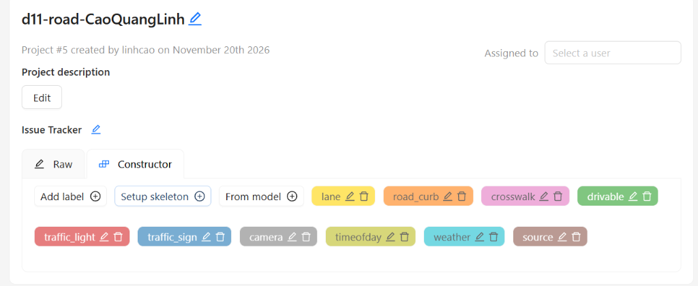
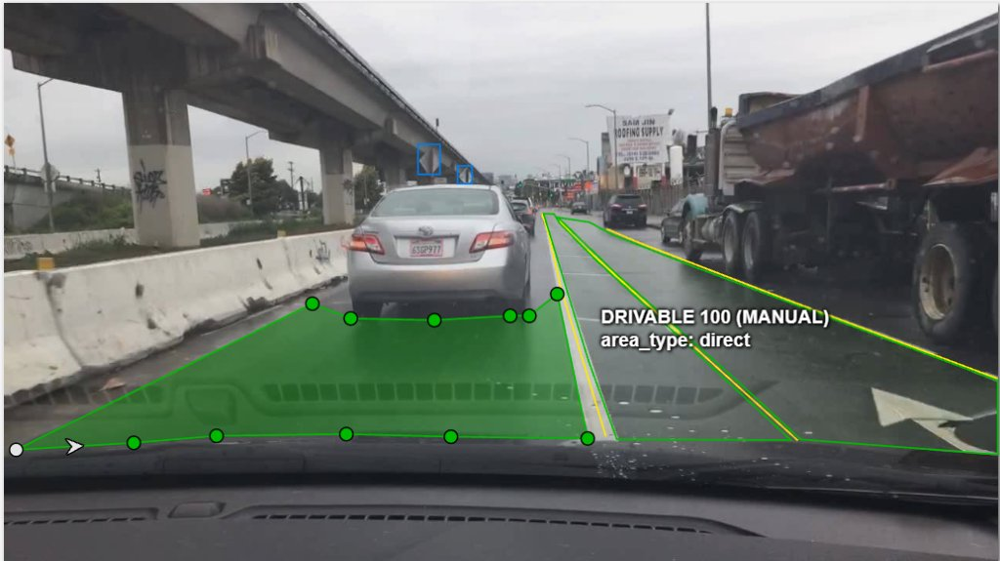
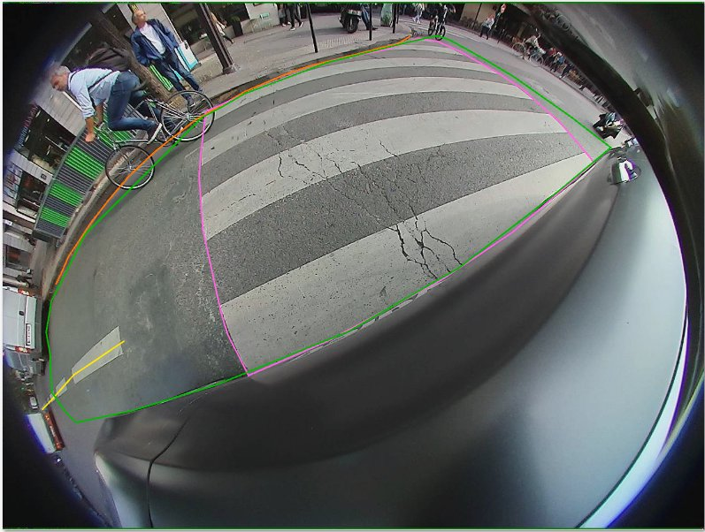
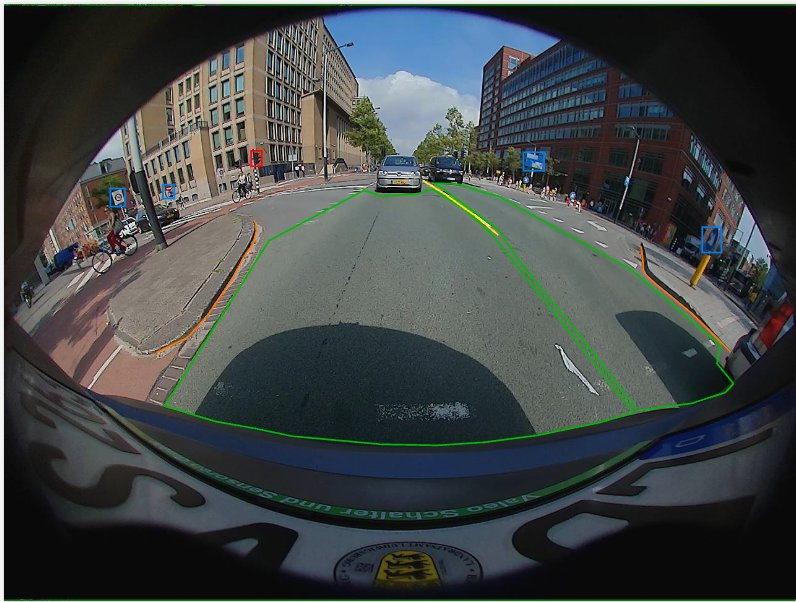
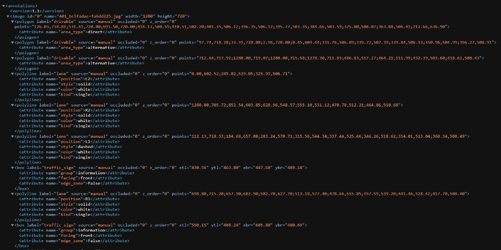

# Báo cáo cá nhân — Ngày 11
Họ tên: Cao Quang Linh               Mã học viên: 2A202603050  
Phiên bản CVAT (Help → About): v2.82.0  
Guideline: Road v1.0    Lần nộp (`revision` trong manifest): 2  
Thời điểm export (ngày giờ trên CVAT): 2026-11-21 01:45    Số lần nộp lại sau Rework: 1 (revision 1 được lưu trong `r1/`)

## 1. Kiểm project
| Mục | Đúng như guideline Road v1.0? | Ghi chú |
| --- | --- | --- |
| 6 label, đúng kiểu | Có | Đủ 6 nhãn: lane (polyline), road_curb (polyline), crosswalk (polygon), drivable (polygon), traffic_light (rectangle), traffic_sign (rectangle). Khớp 100% khai báo trong XML. |
| Thuộc tính và giá trị | Có | Khớp hoàn toàn bảng thuộc tính theo guideline Road v1.0, không thiếu trường nào; `road_check lint` không có lỗi cú pháp taxonomy. |
| 4 tag ảnh | Có | 4 tag dạng select `value`: camera, timeofday, weather, source trên toàn bộ 28 ảnh (16 front, 12 fisheye). |

Cách kết thúc polyline trên bản CVAT này: Nhấn phím N (hoặc click đúp chuột trái tại điểm cuối).  
Cách đặt tag ảnh trên bản CVAT này: Chọn label Tag trên thanh công cụ/menu, sau đó chọn thuộc tính `value` tương ứng (camera, timeofday, weather, source).

## 2. Số lượng đã gán
| Task | Ảnh | lane | road_curb | crosswalk | drivable | traffic_light | traffic_sign |
| --- | ---: | ---: | ---: | ---: | ---: | ---: | ---: | ---: |
| front | 12 | 29 | 12 | 8 | 28 | 24 | 24 |
| front-extra (đã làm 4 / 4) | 4 | 10 | 4 | 2 | 8 | 13 | 12 |
| fisheye | 8 | 7 | 11 | 9 | 7 | 3 | 5 |
| fisheye-extra (đã làm 4 / 4) | 4 | 0 | 3 | 4 | 2 | 0 | 0 |

## 3. Bảng ca khó
| Ảnh | Nhãn | Phân vân giữa | Đã chọn | Lý do |
| --- | --- | --- | --- | --- |
| A05 | lane | Ước lượng L1/R1 qua xe đỗ hay bỏ qua | Bỏ qua | Mặt đường khuất bóng và xe đỗ dày, không thấy rõ vạch sơn; tuân thủ quy tắc không tự bịa vạch, xin ngoại lệ QC1-02. |
| A04 | lane | Vẽ hai polyline hay một polyline `kind=double` | `kind=double` | Vạch vàng đôi tim đường; theo guideline gán 1 polyline dọc tim với `kind=double`. |
| B11 | lane | Gán vạch ô đỗ hay bỏ qua | Bỏ qua | Guideline Road v1.0 quy định không gán vạch bãi đỗ xe (parking stalls), chỉ gán vạch phân làn lưu thông. |
| B08 | lane | `position=L1` hay `position=other` | `other` | Camera bên sườn phải (MVR); quy định bắt buộc camera hai bên sườn (MVL/MVR) gán `position=other`. |

## 4. Phiếu QC 1 nhận được
Bạn kiểm lô của tôi: Đặng Minh Quân    Quyết định nhận được: Release
| Mã lỗi | Số lỗi | Đồng ý? | Đã sửa? |
| --- | ---: | --- | --- |
| QC1-02 | 0 | Đồng ý | Đã xác nhận các ảnh đô thị mờ vạch (A05) thuộc diện miễn trừ hợp lệ |
| QC1-03 | 0 | Đồng ý | Đã rà soát chuẩn `position`: L1/R1/L2/R2 ở front và RV, `other` ở MVL/MVR |
| QC1-04 | 0 | Đồng ý | Đã kiểm tra 100% polyline vẽ từ gần ra xa, đúng tâm vạch sơn |
| QC1-06 | 0 | Đồng ý | Đã chỉnh toàn bộ style, color, kind đúng thực tế, không để mặc định |

Đã đối chiếu revision 1 và revision 2: loại bỏ hoàn toàn các trường hợp polyline trùng L1 ở A04 và A14, chuẩn hóa edge_zone cho các box xa ở B03/B04. Toàn bộ hồ sơ ban đầu được lưu trữ an toàn trong thư mục `r1/`.

## 5. Kiểm file export
| File | Mở lại được? | Số shape ảnh 1 (job / file) | Số shape ảnh 2 (job / file) | Tag camera có trong XML? |
| --- | --- | --- | --- | --- |
| CaoQuangLinh-front.zip | Có | A01: 9 / 9 | A02: 7 / 7 | Có (`front`) |
| CaoQuangLinh-fisheye.zip | Có | B01: 4 / 4 | B02: 6 / 6 | Có (`fisheye_front`) |

File zip đạt chuẩn CVAT for images 1.1, không kèm ảnh gốc (`contains_images: false`), cấu trúc `annotations.xml` chuẩn chỉ. `road_check lint` xác nhận 0 lỗi cú pháp, 0 lỗi fisheye, các cảnh báo còn lại hoàn toàn là ngoại lệ không vạch ở ảnh đường phố đô thị.

## 6. Ảnh chụp màn hình
1. Tab Project → Labels: `evidence/01-project-labels.png`

   

2. Ảnh camera trước đã gán đủ (A07: làn, vùng lái direct/alternative, biển báo): `evidence/02-front-A07.png`

   

3. Ảnh fisheye đã gán (B08 camera sườn MVR và B03 camera sau RV):
   - Camera sườn B08 (vạch người đi bộ crosswalk, làn lane, vùng lái drivable): `evidence/03-fisheye-B08.png`

   

   - Camera sau B03 (vạch làn cong, vỉa hè curb, đèn, biển): `evidence/03b-fisheye-B03.png`

   

4. XML có polyline lane: `evidence/04-annotations-lane.png`

   

## 7. Tự đánh giá
- **Lỗi dễ mắc nhất hôm nay (theo mã QC1-xx) và cách tránh:** Lỗi giữ nguyên thuộc tính mặc định (`L1 / solid / white / single`) khi vẽ vạch lane mới do CVAT tự điền giá trị đầu danh sách. Cách tránh: sau khi kết thúc mỗi polyline (nhấn N), luôn mở ngay bảng Details bên phải để kiểm tra và chỉnh đúng 4 thuộc tính (`position`, `style`, `color`, `kind`).
- **Nhãn đi vào model ở đâu và ảnh hưởng khi gán sai:**
  Nhãn `lane` cung cấp ground truth trực tiếp cho mô hình phát hiện làn đường (dạng Segmentation hoặc Row-Anchor như Ultra-Fast-Lane-Detection). Nếu gán sai thuộc tính `position` (ví dụ: gán nhầm vạch L2/làn bên thành L1):
  1. Hàm mất mát (loss function) sẽ phạt mô hình khi mô hình dự đoán đúng vị trí làn chủ xe đang đi, ép mô hình học sai ranh giới làn đường.
  2. Ở tầng điều khiển ADAS/Tự hành, hệ thống Giữ làn đường (LKA - Lane Keeping Assist) dựa vào L1 và R1 để ước lượng độ lệch ngang của xe so với tim làn (lateral offset). Gán sai L1/R1 sẽ khiến LKA tính toán sai hướng lệch, dẫn đến việc ra lệnh đánh lái giật cục hoặc lệch hẳn sang làn đối diện, gây nguy cơ tai nạn nghiêm trọng.

## 8. (Tùy chọn, buffer) Từ polyline đến đích row-anchor
| y | 720 | 680 | 640 | 600 | 560 |
| --- | ---: | ---: | ---: | ---: | ---: |
| x của chúng tôi | 412 | 458 | 496 | 530 | 561 |
| x của bạn kia | 410 | 456 | 495 | 531 | 563 |

Trả lời 3 câu hỏi:
1. Năm số x đó chính là đích mà một model row-anchor học cho vạch này. Nếu dừng polyline sớm 40 px (ví dụ dừng ở y = 600 thay vì kéo đến 560), hàng y = 560 sẽ bị gán nhãn là "không có làn" (out-of-lane / background), khiến mô hình học tính năng mất dấu vạch ở tầm xa.
2. Ở hàng 720 lệch 2 px, ở hàng 560 lệch 2 px. Lệch ở hàng xa (y = 560) ảnh hưởng lớn hơn tới độ cong và dự báo hướng lái của LKA (theo slide 25), vì sai lệch góc nhỏ ở xa sẽ phóng đại thành sai số quỹ đạo lớn khi xe di chuyển ở tốc độ cao.
3. Nếu polyline vẽ từ xa về gần (ngược quy tắc), thuật toán nội suy `x = f(y)` khi duyệt điểm sẽ bị đảo chiều chỉ số hoặc sai hướng vector tiếp tuyến; script nội suy lát cắt ngang (`interpolate_row_anchor`) sẽ phải thêm bước đảo ngược thứ tự mảng điểm trước khi xử lý, nếu không sẽ sinh ra tọa độ nghịch đảo hoặc lỗi monotonic.
